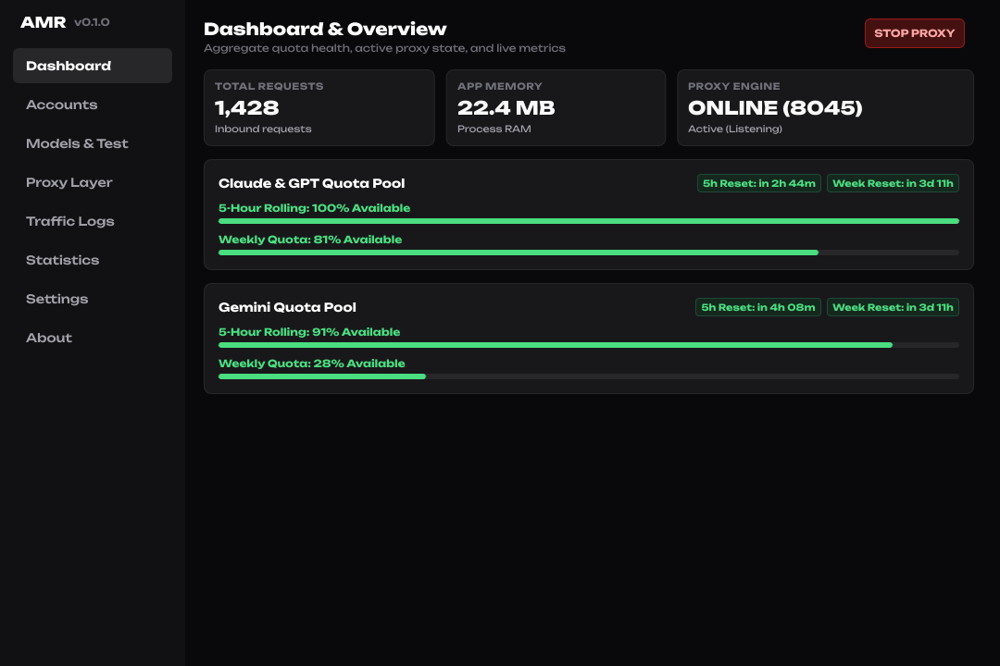
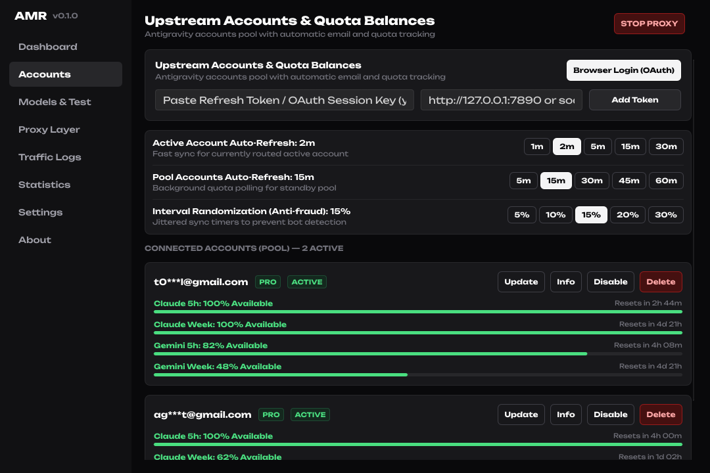
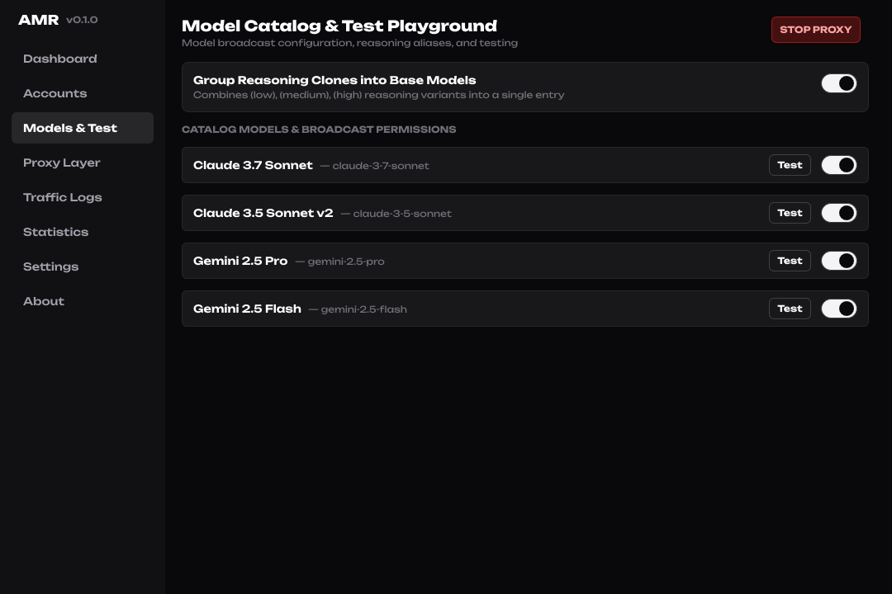
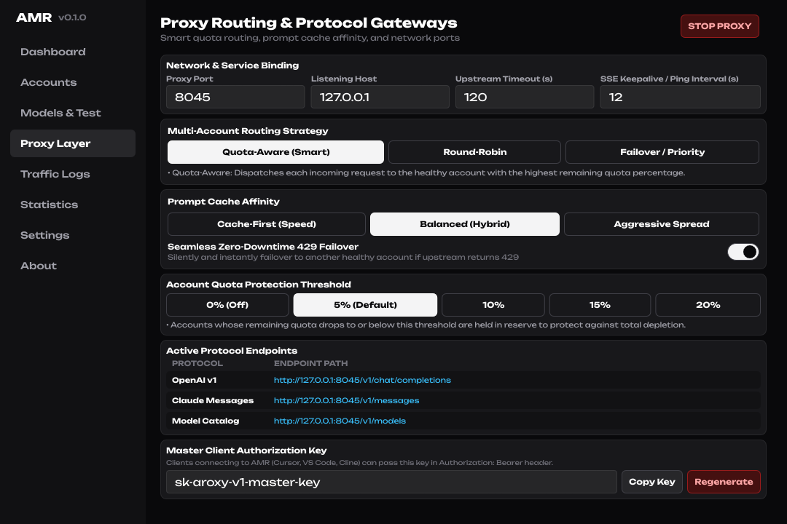
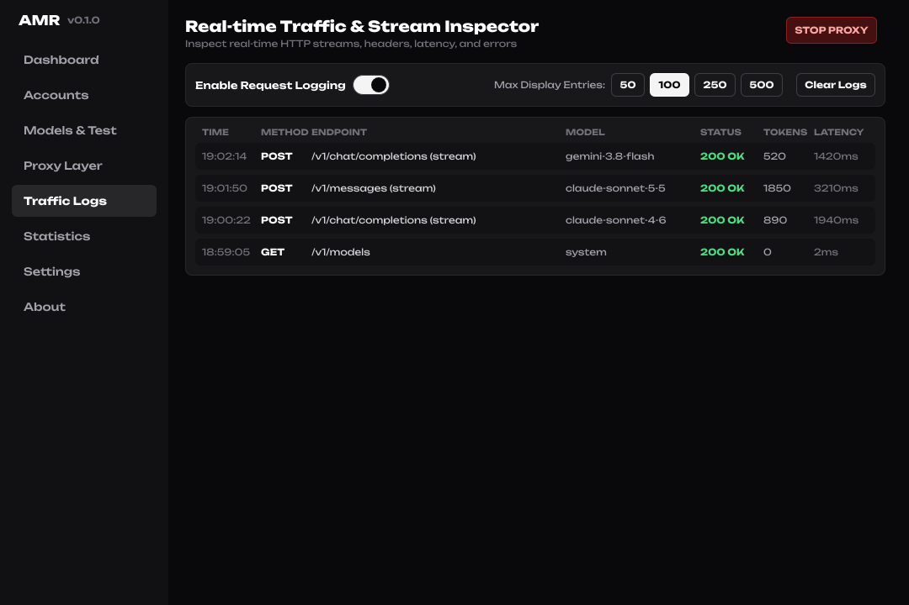
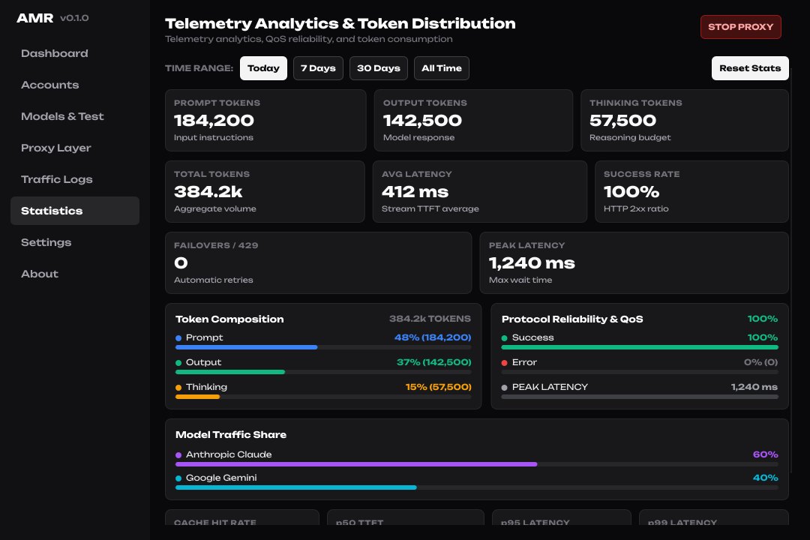
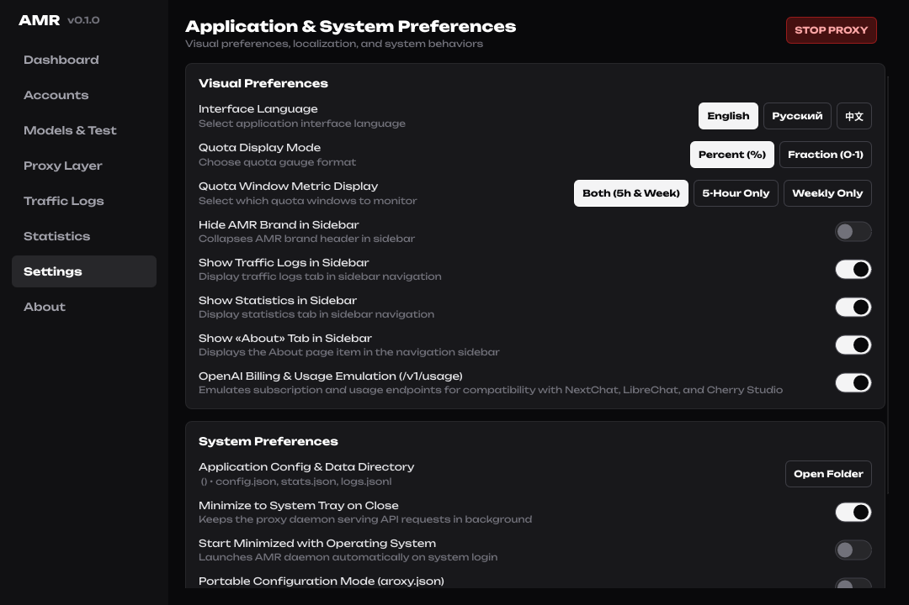

<div align="center">


# AMR (Antigravity Manager Rust)

**Ultra-lightweight, high-performance AI protocol proxy & multi-account quota manager.**  
*Native Linux & Windows (x86_64 & ARM64) • Pure Rust • Hardware-Accelerated Slint GUI • Zero Telemetry*

[](LICENSE)
[](https://www.rust-lang.org/)
[](https://slint.dev/)
[]()
[](https://github.com/Qyzom/Antigravity-Manager-Rust/releases)

<br/>



<br/><br/>




<br/>




<br/>




</div>

---

### Overview & Philosophy

**AMR (Antigravity Manager Rust)** is a cross-platform local AI protocol proxy and load balancer written in pure Rust. It transforms multiple upstream accounts into unified local endpoints compatible with **OpenAI** (`/v1/chat/completions`, `/v1/models`) and **Anthropic Claude** (`/v1/messages`), supporting modern AI coding tools and agents including **Roo Code**, **Claude Code**, **Cline**, **Cursor**, **Codex**, **OpenCode**, and **Continue.dev**.

> [!NOTE]
> **Focused Scope vs All-in-One "Combines":**  
> AMR is purpose-built strictly for high-throughput protocol emulation, proxying, and quota-aware routing.  
> AMR **is not and will not become a bloated all-in-one combine**: it does not hook into local IDE process memory, does not modify local SQLite/LevelDB editor storage, and does not inject cookies. Dedicated local helper scripts already handle local disk credentials much better. AMR does one thing with uncompromising efficiency: fast, stable, zero-telemetry API proxying (`127.0.0.1:8045`).

---

### Core Architecture

- **Zero Telemetry:** Free of analytics, tracking libraries, ads, and telemetry collectors.
- **Low Memory Overhead:** Idles at **~22 MB RSS** with the native hardware-accelerated GUI and **< 3 MB** in headless CLI daemon mode.
- **Native GUI Rendering:** Built with **Slint 1.9** on top of FemtoVG / OpenGL without bundled Chromium or system WebKitGTK runtime dependencies.
- **Stream Resilience & Heartbeats:** Automatic SSE heartbeat frames (`: ping\n\n`) to prevent client timeouts during extended thinking periods (Claude 3.7 Thinking, o1/o3, Gemini 2.5), alongside configurable micro-chunk stream pacing.

---

### Key Features

- **Multi-Protocol Translation:** Bidirectional conversion between OpenAI and Anthropic Claude protocols with full thinking/reasoning preservation (with upstream Google Cloud Code Pa API mapping).
- **Dual-Mode Reasoning Configuration:** Handles both suffix naming conventions (`-low`, `-medium`, `-high`, `(low)`) and native protocol parameters (`reasoning_effort`, `thinking`).
- **Quota-Aware Load Balancing:** Dynamic quota accounting with automatic 429 failover, sticky session affinity, and configurable emergency reserve thresholds.
- **Hardware Isolation Profiles:** Distinct device IDs and machine GUIDs per upstream account, with optional randomized jitter (+-15%) for network cadence smoothing.
- **Request Inspector & Disk Logging:** Searchable HTTP traffic log with per-request latency, token counts (Prompt, Completion, Thinking), status codes, and payload inspector.
- **Internationalization (i18n):** Complete localization in English, Russian, and Chinese across all UI tabs, tray menus, and system notifications.

---

### Technical Comparison

| Specification | AntigravityManager (Draculabo) | Antigravity-Manager (lbjlaq) | AMR |
| :--- | :---: | :---: | :---: |
| **Tech Stack** | TypeScript, Electron 37, Node.js 24 | Rust, Tauri v2, WebKitGTK | **Pure Rust (Tokio, Axum, Slint 1.9)** |
| **Tracked Repository Files** | 2,597 files | 598 files | **61 files** |
| **GUI RAM (RSS)** | ~220 – 380 MB | ~120 – 180 MB | **~22 MB** |
| **Headless / Daemon Mode** | Not supported | Not supported | **Supported (~2.5 MB RAM)** |
| **Cold Startup Latency** | 3.5 – 5.0 s | 1.5 – 2.2 s | **< 60 ms** |
| **Package Size** | ~95 MB (AppImage) | ~45 MB (+ WebKitGTK runtime) | **~14 MB (AppImage)** |
| **Web Runtime Dependency** | Bundled Chromium | System WebKitGTK | **None (Native OpenGL / FemtoVG)** |
| **Telemetry Packages** | Sentry, Microsoft Clarity, OpenTelemetry | None | **None** |
| **License** | MIT License | CC-BY-NC-SA-4.0 | **MIT License** |
| **SSE Heartbeat Frame Injection** | Raw upstream SSE | Raw upstream SSE | **Auto-injected (`: ping\n\n`)** |
| **Stream Micro-Chunk Pacing** | Raw upstream chunks | Raw upstream chunks | **Sub-token configurable pacing** |
| **Reasoning Effort Support** | Partial suffixes | Suffixes | **Suffixes + Native Protocol** |

> *\* Real-world benchmarks performed on **Arch Linux** under identical test conditions.*  
> *\* Software versions tested: AMR `v0.1.1` vs AntigravityManager `v0.30.0` (Draculabo) vs Antigravity-Manager `v5.0.0` (lbjlaq).*

---

### Downloads

Pre-built binaries and distribution packages for AMR `v0.1.1` (x86_64 and native ARM64) are available on the [**Releases**](https://github.com/Qyzom/Antigravity-Manager-Rust/releases/latest) page:

| OS / Format | Architecture | Package File | Description |
| :--- | :---: | :--- | :--- |
| **Linux (AppImage)** | `x86_64` | `AMR-0.1.1-x86_64.AppImage` | Portable executable (runs on any modern Linux) |
| **Linux (Debian / Ubuntu)** | `x86_64` / `arm64` | `AMR_0.1.1_amd64.deb`<br/>`AMR_0.1.1_arm64.deb` | Standard `.deb` package with system desktop & menu integration |
| **Linux (Fedora / RHEL)** | `x86_64` / `aarch64` | `AMR-0.1.1-1.x86_64.rpm`<br/>`AMR-0.1.1-1.aarch64.rpm` | Standard `.rpm` package with system desktop & menu integration |
| **Windows 10 / 11** | `x86_64` | `AMR-0.1.1-x86_64.exe` | Portable 64-bit executable with system tray support |
| **Windows on ARM** | `arm64` | `AMR-0.1.1-arm64.exe` | Native ARM64 executable for Snapdragon X Elite / Surface Pro |

---

### Quick Start

#### Linux (AppImage)

```bash
chmod +x AMR-0.1.1-x86_64.AppImage

# Launch GUI:
./AMR-0.1.1-x86_64.AppImage

# Launch in headless daemon mode:
./AMR-0.1.1-x86_64.AppImage --headless --port 8045

# Start minimized to system tray:
./AMR-0.1.1-x86_64.AppImage --start-minimized
```

#### Linux (Debian / Ubuntu)

```bash
sudo dpkg -i AMR_0.1.1_amd64.deb
```

#### Linux (Fedora / RHEL)

```bash
sudo rpm -i AMR-0.1.1-1.x86_64.rpm
```

#### Windows

Download `AMR-0.1.1-x86_64.exe` and execute it. AMR automatically integrates with the system tray and offers automatic startup on login.

---

### CLI Command Options

```text
AMR (Antigravity Manager Rust) — Ultra-lightweight AI API Proxy & Emulator

Usage: amr [OPTIONS]

Options:
      --headless             Run proxy in headless mode without graphical UI
  -p, --port <PORT>          Override local listening port [default: 8045]
      --start-minimized      Start minimized directly to system tray
  -c, --config <PATH>        Custom config file path
      --take-screenshots <DIR> Capture UI screenshots in English and exit
  -h, --help                 Print help
  -V, --version              Print version
```

---

### Client Integration Guide

AMR listens on `http://127.0.0.1:8045` by default:

---

### Stealth, Anti-Detection & Upstream Emulation Architecture

AMR provides a specialized anti-detection engine designed to replicate genuine Google Antigravity communication 1-to-1:

1. **Authentic Binary Signatures & Client Metadata:**
   - **Go SDK Header:** Emulates the official Go language server runtime via `X-Goog-Api-Client: gl-go/1.28.0 gdcl/0.1.0`.
   - **Client Info Payload:** Injects official IDE telemetry into requests (`clientType: "ANTIGRAVITY"`, `ideType: "ANTIGRAVITY"`, `ideVersion: "2.28.1"`).
   - **Production Endpoint Enforcement:** Locks requests strictly to production API gateways (`cloudcode-pa.googleapis.com`), preventing suspicious flapping to internal Google sandboxes (`daily-cloudcode-pa`, `.sandbox.googleapis.com`).

2. **Adaptive Exponential Backoff Ladder (Anti-429 Protection):**
   - When an account receives an HTTP 429 (`Too Many Requests`), it is never hammered in rapid retry loops. Instead, AMR steps the account through an adaptive backoff ladder:
     - **Level 1 (Soft Pause):** ~3s pause (±15% jitter).
     - **Level 2 (Backoff):** ~15s pause (±15% jitter).
     - **Level 3 (Cooldown):** ~60s pause (±15% jitter).
     - **Level 4 (Quarantine):** ~300s quarantine (±15% jitter).
   - While an account is in cooldown, the load balancer automatically routes traffic to other healthy accounts.

3. **Auto-Heal Probing:**
   - Once an account's backoff timer expires, it enters a **Probing** state. AMR safely routes a single trial request to the account. Upon a successful response (HTTP 200), Auto-Heal is triggered: the failure counter is reset to zero, and the account returns to full `Healthy` status.

4. **Randomized Timing Jitter (±15% Spread):**
   - Applies randomized micro-delays (15–45 ms) and ±15% backoff variations to destroy synthetic machine periodicities and avoid bot-detection heuristics.

---

#### 1. Claude Code CLI
```bash
export ANTHROPIC_BASE_URL="http://127.0.0.1:8045"
export ANTHROPIC_API_KEY="sk-amr-local-proxy"
claude
```

#### 2. Roo Code / Cline (VS Code Extension)
- **API Provider:** `OpenAI Compatible`
- **Base URL:** `http://127.0.0.1:8045/v1`
- **API Key:** `sk-amr-local-proxy`
- **Model ID:** `claude-3-7-sonnet`, `gemini-2.5-pro`, or `claude-3-5-sonnet`

#### 3. Cursor IDE
- **Settings** -> **Models** -> **OpenAI API Key**: `sk-amr-local-proxy`
- **Override OpenAI Base URL**: `http://127.0.0.1:8045/v1`
- Supported models: `claude-3-7-sonnet`, `claude-3-7-sonnet-high`, `gemini-2.5-pro`, `gemini-2.5-flash`

#### 4. Continue.dev
```json
{
  "models": [
    {
      "title": "AMR Claude 3.7",
      "provider": "openai",
      "model": "claude-3-7-sonnet",
      "apiBase": "http://127.0.0.1:8045/v1",
      "apiKey": "sk-amr-local-proxy"
    }
  ]
}
```

#### 5. DeepSeek Harness / NextChat / OpenWebUI
- **Base URL**: `http://127.0.0.1:8045/v1`
- **API Key**: `sk-amr-local-proxy`

#### 6. Python OpenAI SDK
```python
from openai import OpenAI

client = OpenAI(
    base_url="http://127.0.0.1:8045/v1",
    api_key="sk-amr-local-proxy",
)

response = client.chat.completions.create(
    model="claude-3-7-sonnet",
    messages=[{"role": "user", "content": "Explain quantum computing in three sentences."}],
    stream=True,
)

for chunk in response:
    content = chunk.choices[0].delta.content or ""
    print(content, end="", flush=True)
```

---

### Building from Source

#### Prerequisites
- Rust 1.75+ toolchain (`cargo`, `rustc`)
- Linux libraries: `libfontconfig1-dev`, `libxkbcommon-dev` (for GUI build)

```bash
git clone https://github.com/Qyzom/Antigravity-Manager-Rust.git
cd Antigravity-Manager-Rust

# Run tests
cargo test

# Build release binary
cargo build --release --bin amr

# Package Linux artifacts (AppImage, deb, rpm)
./packaging/linux/build_appimage.sh 0.1.0
./packaging/linux/build_deb.sh 0.1.0
./packaging/linux/build_rpm.sh 0.1.0
```

---

### Maintenance & Release Philosophy

- **Cumulative, Milestone Releases:** AMR intentionally avoids the pattern of churning out dozens of fragmented micro-releases every week (*"a patch of a patch holding a patch"*). We believe software should be thoroughly tested and reliable before distribution.
- **Periods of Silence are Normal:** Absence of commits for a few weeks or months is completely normal and indicates a mature, stable engine that requires zero intervention. You can confidently download and use AMR knowing it is stable.
- **Explicit Lifecycle Transparency:** If the maintainer ever decides to discontinue active development in the future, the repository will be transparently transitioned to **Archived** status on GitHub rather than left in an unmaintained or ambiguous state.

---

### License & Attribution

AMR is distributed under the [MIT License](LICENSE).

#### Third-Party Components & Fonts
- **Unbounded Font:** Licensed under the [SIL Open Font License, Version 1.1](http://scripts.sil.org/OFL) (Copyright 2022 The Unbounded Project Authors).
- **Slint GUI Framework:** Used under the terms of the Royalty-Free Desktop Application License / GPLv3.
