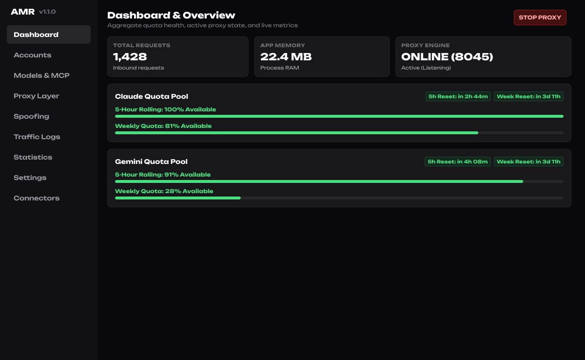
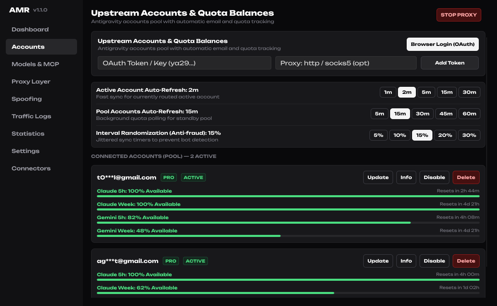
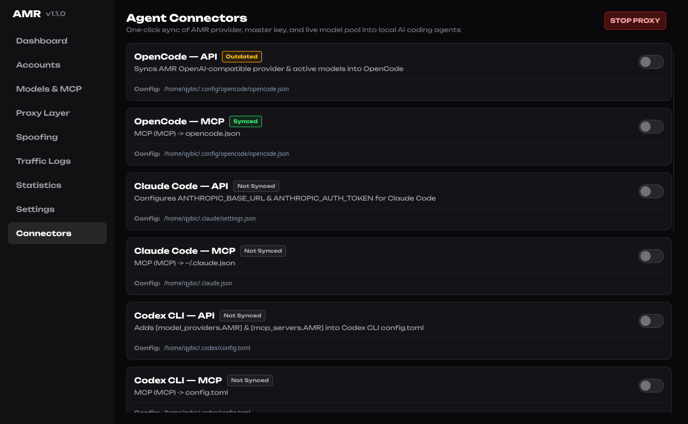
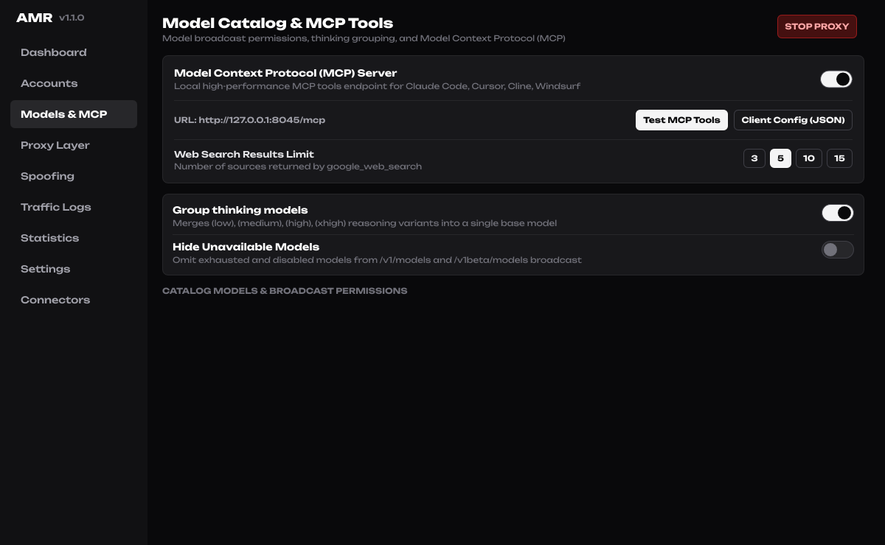
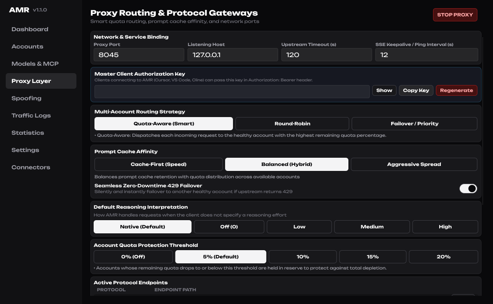
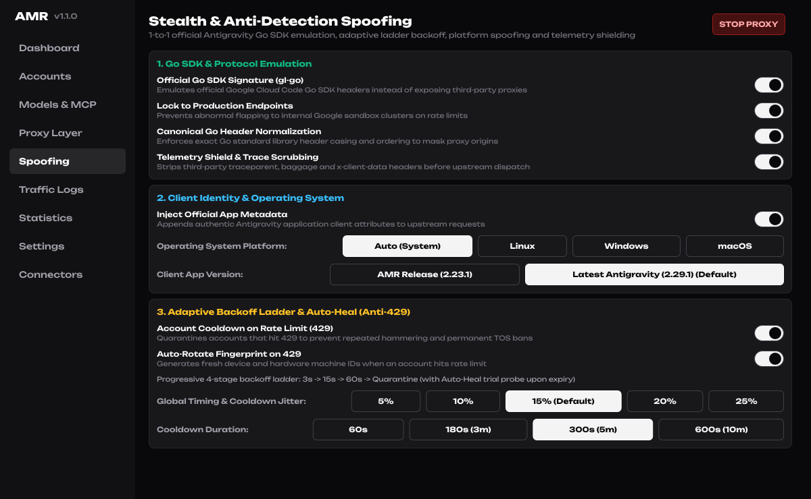
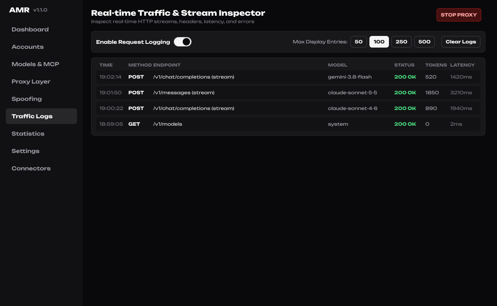
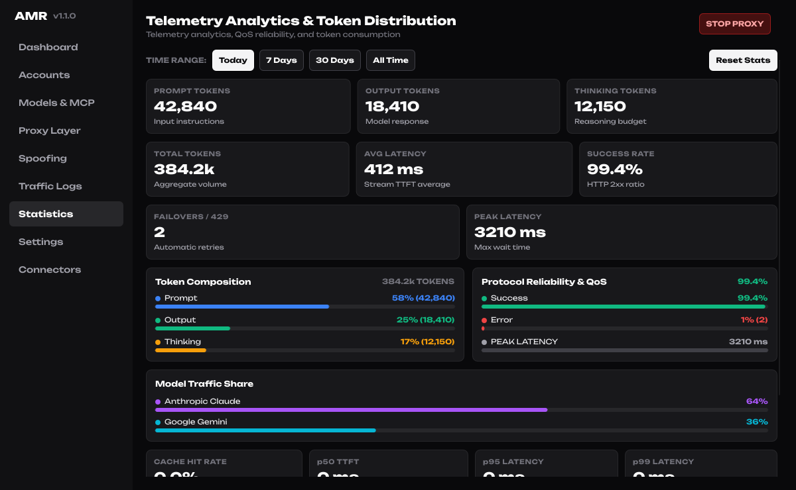
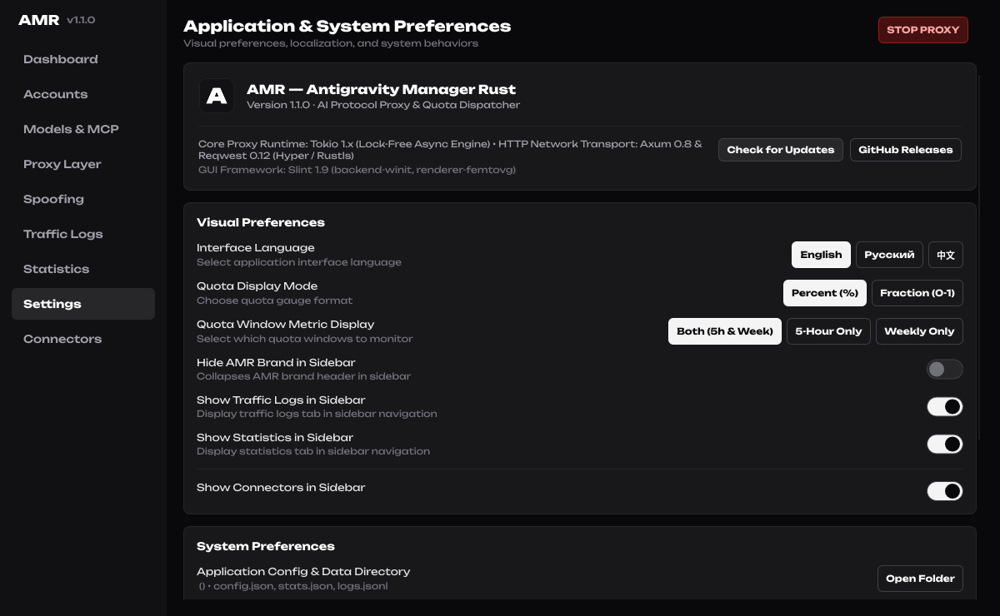

<div align="center">


# AMR (Antigravity Manager Rust)

**Ultra-lightweight, high-performance AI protocol proxy & multi-account quota manager.**  
*Native Linux & Windows (x86_64 & ARM64) • Pure Rust • BoringSSL TLS/HTTP2 • Slint 1.18 GUI • Zero Telemetry*

[](https://github.com/Qyzom/Antigravity-Manager-Rust/releases)
[](LICENSE)
[](https://www.rust-lang.org/)
[-10b981.svg)](https://github.com/0x676e67/wreq)
[](https://slint.dev/)
[]()

<br/>



<br/><br/>




<br/>




<br/>




<br/>




</div>

---

### What's New in `v1.1.0` — Full Legacy Purge & BoringSSL Rewrite

> [!IMPORTANT]
> **Масштаб релиза `v1.1.0` (`v1.0.0..HEAD`):** переписано и очищено **24 файла (+4,139 / -2,614 строк)**.  
> Выполнена **полная очистка легаси**, полный переезд HTTP-стека на **BoringSSL** (без фоллбэков на `reqwest`/`rustls`), добавлена вкладка **Connectors** и закрыты все выявленные уязвимости и гонки.

- **Полная очистка легаси и дедупликация (Full Legacy Purge):**
  - Выпилено **116 мёртвых i18n-ключей**, **140 неиспользуемых полей `I18nData`**, **22 неиспользуемых Slint-свойства**, **9 мёртвых коллбэков**, **7 неиспользуемых SVG-графиков**, мёртвые структуры Gemini и остатки `image_generation_models`.
  - Дедуплицирована синхронизация квот и моделей аккаунтов (`sync_account_quota_and_models`), а тяжёлый дисковый/сетевой I/O вынесен с async-рантайма в `spawn_blocking` (логи, статистика, массовый sync).
- **BoringSSL TLS/HTTP2 Имперсонация (`wreq` + `wreq-util`):**
  - Полный отказ от `reqwest`/`rustls` без каких-либо фоллбэков: весь исходящий трафик идёт через `wreq` на базе **BoringSSL** с нативной подменой TLS JA3/JA4 и HTTP/2 `SETTINGS` профилей Chrome (`Chrome134`/`135`/`136` детерминированно на аккаунт).
  - Изолированные пулы соединений и TLS-сессий на каждую пару `account.id | proxy_url`.
- **Протокольная привязка `DeviceProfile`:**
  - `loadCodeAssist` теперь передаёт корректную ОС `platform` (`WINDOWS` / `MACOS` / `LINUX`) в `metadata`.
  - Префикс `conv` в `payload["requestId"]` детерминированно привязан к `machine_id` аккаунта — полная консистентность устройства на уровне протокола без утечки синтетических HTTP-заголовков (`x-machine-id`, `x-client-id`).
- **Split API & MCP Connectors (`connectors.rs`):**
  - Новая вкладка **Connectors** с раздельной синхронизацией API и MCP конфигов для **OpenCode**, **Claude Code**, **Codex CLI**, **Cursor**, **Windsurf**, **Cline**, **Roo Code** и **Continue.dev**.
  - Поддержка автосинхронизации при смене порта/ключа, очистка UTF-8 BOM и JSONC-комментариев (`strip_jsonc`), безопасная замена managed-блоков в TOML/JSON.
- **Усиление безопасности и изоляции:**
  - Жёсткая проверка `require_master_api_key` на защищённых роутах, CSRF-валидация `state` и `escape_html` от XSS в OAuth-коллбэке, строгий локальный CORS.
  - Singleflight + `SAVE_LOCK` при обновлении OAuth-токенов (исключены гонки и порча `config.json`).
  - Per-hop SSRF/DNS-pinning в MCP `fetch_web_page` (`Policy::none()` + `tokio::net::lookup_host` + проверка каждого редиректа).
- **Точность квот, балансировщика и стриминга:**
  - Atomic single-probe защита (`probing_in_flight` + `clear_probing`) от одновременного прощупывания аккаунта.
  - Честные `0%` квот при отсутствии доступных моделей или бакетов Claude/Gemini (без ложных 100%).
  - Разделение не-повторяемых `403 VALIDATION_REQUIRED` / `SUBSCRIPTION_REQUIRED` без лишнего карантина соседних аккаунтов.
  - UTF-8 безопасный `SseByteBuffer` (лимит 4 MiB, не рвёт многобайтные символы), удаление `temperature` при активном `thinkingConfig`, и полная трансляция `tool_use` / `input_json_delta` + parallel tool calls между OpenAI и Claude.

---

### Overview & Philosophy

**AMR (Antigravity Manager Rust)** is a cross-platform local AI protocol proxy and load balancer written in pure Rust. It transforms multiple upstream accounts into unified local endpoints compatible with **OpenAI** (`/v1/*`), **Anthropic Claude** (`/v1/messages`), **Google Gemini Native** (`/v1beta/models/*`), and **Model Context Protocol (MCP)** (`/mcp`), supporting modern AI coding tools and agents including **OpenCode**, **Claude Code**, **Codex CLI**, **Roo Code**, **Cline**, **Cursor**, **Windsurf**, and **Continue.dev**.

> [!NOTE]
> **Focused Scope vs All-in-One "Combines":**  
> AMR is purpose-built strictly for high-throughput protocol emulation, proxying, and quota-aware routing.  
> AMR **is not and will not become a bloated all-in-one combine**: it does not hook into local IDE process memory, does not modify local SQLite/LevelDB editor storage, and does not inject cookies. AMR does one thing with uncompromising efficiency: fast, stable, zero-telemetry API proxying (`127.0.0.1:8045`).

---

### Core Architecture

- **Zero Telemetry:** Free of analytics, tracking libraries, ads, and telemetry collectors.
- **Low Memory Overhead:** Idles at **~22 MB RSS** with the native hardware-accelerated GUI and **< 3 MB** in headless CLI daemon mode.
- **Native GUI Rendering:** Built with **Slint 1.18** on top of FemtoVG / OpenGL without bundled Chromium or system WebKitGTK runtime dependencies.
- **BoringSSL Network Stack:** Powered by `wreq` (`btls-sys` / BoringSSL) with genuine Chrome TLS JA3/JA4 and HTTP/2 `SETTINGS` impersonation and per-account pool isolation.
- **Stream Resilience & Heartbeats:** Automatic SSE heartbeat frames (`: ping\n\n`) to prevent client timeouts during extended thinking periods, UTF-8 safe `SseByteBuffer`, and configurable micro-chunk stream pacing.

---

### Complete Antigravity Feature Emulation (Beyond Chat)

- **Native Audio Speech-to-Text (`POST /v1/audio/transcriptions`):**
  High-accuracy multimodal speech recognition via native `gemini-3.5-transcribe` (powered by Google Gemini Flash multimodal audio), with transparent drop-in compatibility for OpenAI Whisper clients (`whisper-1` / `stt-1`).
- **Antigravity Agent Protocol & `DeviceProfile` Binding:**
  Genuine Antigravity client metadata envelopes (`requestId: "agent/{conv}/{ts}/{traj}/1"`, `userAgent: "antigravity"`, `requestType: "agent"`) with `conv` deterministically bound to each account's `machine_id` and OS `platform` in `loadCodeAssist`.
- **Built-in Model Context Protocol (MCP) Server (`/mcp` & `/v1/mcp`):**
  Direct tool integration for Claude Code, OpenCode, Codex CLI, Cursor, Cline, and Windsurf providing `google_web_search` (grounded live search with citations) and `fetch_web_page` (per-hop SSRF-hardened markdown web fetcher).
- **Strict Error Transparency & Zero Fake Layers:**
  AMR strictly exposes authentic upstream capabilities without artificial mocks or brittle scrapers. Unsupported modalities on standard Cloud Code Pa licenses (stateless REST TTS and enterprise-only image generation) are cleanly excluded.

---

### Key Features

- **Triple Protocol Gateway:** Native unified support for OpenAI API (`/v1/*`), Anthropic Claude API (`/v1/messages`), and Google Gemini Native API (`/v1beta/models/*:generateContent` / `streamGenerateContent`) with bidirectional `tool_use` / `tool_calls` translation.
- **Split API & MCP Connectors:** One-click & auto-syncing config integration for OpenCode, Claude Code, Codex CLI, Cursor, Windsurf, Cline, Roo Code, and Continue.dev with JSONC/BOM support.
- **Embedded MCP Server & Tooling:** Built-in `/mcp` HTTP endpoint providing `google_web_search` and `fetch_web_page` tools with interactive testing in the UI.
- **Model Status & Diagnostics:** Instant diagnostic dialog showing model metadata, provider, per-account availability breakdown, last failure reason, and a single "Run Diagnostics" button.
- **Hard Proxy Blocking on Disabled Models:** Strips `-disabled` from model identifiers; disabled models return strict HTTP 403 on all proxy routes.
- **Default Thinking Grouping:** Base models grouped by default with inverted toggle (*«Разгруппировать модели по уровню мышления»* / Ungroup thinking models), mapping `reasoning_effort` / `thinking` cleanly.
- **Quota-Aware Load Balancing:** Dynamic Claude/Gemini quota calculus, single-probe guard (`probing_in_flight`), automatic 429 failover ladder, sticky session affinity, and emergency reserve thresholds.
- **Hardware Isolation Profiles:** Distinct `DeviceProfile` (`machine_id`, `dev_device_id`) and isolated BoringSSL Chrome TLS/HTTP2 pools per account, with optional randomized jitter (±15%).
- **Request Inspector & Disk Logging:** Searchable HTTP traffic log with per-request latency, token counts (Prompt, Completion, Thinking), status codes, and payload inspector.
- **Internationalization (i18n):** Complete localization in English, Russian, and Chinese across all UI tabs, tray menus, and notifications.

---

### Technical Comparison

| Specification | AntigravityManager (Draculabo) | Antigravity-Manager (lbjlaq) | AMR (`v1.1.0`) |
| :--- | :---: | :---: | :---: |
| **Tech Stack** | TypeScript, Electron 37, Node.js 24 | Rust, Tauri v2, WebKitGTK | **Pure Rust (Tokio, Axum, Slint 1.18)** |
| **TLS / HTTP2 Stack** | Node/Chromium | `rquest` (BoringSSL) | **`wreq` (BoringSSL JA3/JA4 + HTTP/2)** |
| **Per-Account Pool & Profile** | Shared | Per-account | **Isolated `account.id \| proxy_url` + `DeviceProfile` binding** |
| **GUI RAM (RSS)** | ~220 – 380 MB | ~120 – 180 MB | **~22 MB** (with `malloc_trim`) |
| **Headless / Daemon Mode** | Not supported | Not supported | **Supported (< 3 MB RAM)** |
| **Cold Startup Latency** | 3.5 – 5.0 s | 1.5 – 2.2 s | **< 60 ms** |
| **Package Size** | ~95 MB (AppImage) | ~45 MB (+ WebKitGTK runtime) | **~14 MB (AppImage)** |
| **Web Runtime Dependency** | Bundled Chromium | System WebKitGTK | **None (Native OpenGL / FemtoVG)** |
| **Telemetry Packages** | Sentry, Microsoft Clarity, OpenTelemetry | None | **None** |
| **License** | MIT License | CC-BY-NC-SA-4.0 | **MIT License** |
| **IDE / CLI Auto-Sync** | Manual | Manual | **Split API & MCP Connectors (JSONC/TOML)** |
| **Reasoning Effort & Tools** | Partial suffixes | Suffixes | **Suffixes + Native Protocol + Parallel `tool_use`** |
| **Audio Speech-to-Text (`/v1/audio/transcriptions`)** | ❌ Unsupported | ❌ Unsupported | **Native `gemini-3.5-transcribe` / Multimodal STT** |
| **Built-in MCP Server (`/mcp`)** | ❌ None | ❌ None | **Native SSRF-Hardened (`google_web_search` & `fetch_web_page`)** |

> *\* Real-world benchmarks performed on **Arch Linux** under identical test conditions.*  
> *\* Software versions tested: AMR `v1.1.0` vs AntigravityManager `v0.30.0` (Draculabo) vs Antigravity-Manager `v5.0.0` (lbjlaq).*

---

### Downloads

Pre-built standalone binaries and distribution packages for the latest AMR release are available on the [**Releases**](https://github.com/Qyzom/Antigravity-Manager-Rust/releases/latest) page (replace `<VERSION>` with the downloaded release tag, e.g. `1.1.0`):

#### 🐧 Linux — Intel & AMD 64-bit (`x86_64`)
| Format / Distro | Package File | Description |
| :--- | :--- | :--- |
| **AppImage (Portable)** | `AMR-<VERSION>-x86_64.AppImage` | Portable binary (runs on any Linux distribution without installation) |
| **DEB (Ubuntu / Debian)** | `AMR_<VERSION>_amd64.deb` | Standard package for Ubuntu, Debian, Linux Mint, Pop!_OS with desktop menu integration |
| **RPM (Fedora / RHEL)** | `AMR-<VERSION>-1.x86_64.rpm` | Standard package for Fedora, RHEL, openSUSE, AlmaLinux, Rocky Linux |

#### 🐧 Linux — ARM 64-bit (`ARM64` / `aarch64`)
| Format / Distro | Package File | Description |
| :--- | :--- | :--- |
| **AppImage (Portable ARM64)** | `AMR-<VERSION>-aarch64.AppImage` | Portable ARM64 binary for Raspberry Pi 4/5, Apple Silicon Linux VMs, ARM servers |
| **DEB (Ubuntu / Debian ARM64)**| `AMR_<VERSION>_arm64.deb` | Standard package for Ubuntu & Debian on 64-bit ARM architectures |
| **RPM (Fedora / RHEL ARM64)** | `AMR-<VERSION>-1.aarch64.rpm` | Standard package for Fedora & RHEL on 64-bit ARM architectures |

#### 🪟 Windows — Intel & AMD 64-bit (`x86_64`)
| Format | Package File | Description |
| :--- | :--- | :--- |
| **Portable EXE** | `AMR-<VERSION>-x86_64.exe` | Native standalone GUI executable (no console window) with system tray |

#### 🪟 Windows — ARM 64-bit (`ARM64`)
| Format | Package File | Description |
| :--- | :--- | :--- |
| **Portable EXE (ARM64)** | `AMR-<VERSION>-arm64.exe` | Native ARM64 executable for Snapdragon X Elite, Surface Pro & ARM64 laptops |

---

### Quick Start

#### Linux (AppImage)

```bash
chmod +x AMR-1.1.0-x86_64.AppImage

# Launch GUI:
./AMR-1.1.0-x86_64.AppImage

# Launch in headless daemon mode:
./AMR-1.1.0-x86_64.AppImage --headless --port 8045

# Start minimized to system tray:
./AMR-1.1.0-x86_64.AppImage --start-minimized
```

#### Linux (Debian / Ubuntu)

```bash
sudo dpkg -i AMR_1.1.0_amd64.deb
```

#### Linux (Fedora / RHEL)

```bash
sudo rpm -i AMR-1.1.0-1.x86_64.rpm
```

#### Windows

Download `AMR-1.1.0-x86_64.exe` and execute it. AMR runs as a native Windows desktop GUI application (without command prompt), integrates with the system tray, and supports one-click Google OAuth via native ShellExecute.

---

### CLI Command Options

```text
AMR (Antigravity Manager Rust) — Ultra-lightweight AI API Proxy & Emulator

Usage: amr [OPTIONS]

Options:
      --headless                 Run proxy in headless mode without graphical UI
  -p, --port <PORT>              Override local listening port [default: 8045]
      --start-minimized          Start minimized directly to system tray
  -c, --config <PATH>            Custom config file path
      --take-screenshots <DIR>   Capture UI screenshots in English and exit
  -h, --help                     Print help
  -V, --version                  Print version
```

---

### Stealth, Anti-Detection & Upstream Emulation Architecture

AMR provides a specialized anti-detection engine designed to replicate genuine Google Antigravity communication 1-to-1:

1. **BoringSSL TLS/HTTP2 Impersonation & Protocol Binding:**
   - **Browser-Grade Transport (`wreq`):** Replicates authentic Chrome TLS JA3/JA4 handshakes and HTTP/2 `SETTINGS` frames per account (`Chrome134`/`135`/`136`), eliminating `rustls` transport fingerprinting.
   - **Protocol-Level `DeviceProfile`:** Deterministically binds the `conv` prefix in `payload["requestId"]` to the account's `machine_id` and sends OS `platform` in `loadCodeAssist` without leaking synthetic HTTP headers.
   - **Go SDK & Client Envelope:** Emulates `X-Goog-Api-Client: gl-go/1.28.0 gdcl/0.1.0`, authentic IDE metadata (`ideType: "ANTIGRAVITY"`, `ideVersion: "2.29.1"`), and locks to production endpoints (`daily-cloudcode-pa.googleapis.com`).

2. **Adaptive Exponential Backoff Ladder (Anti-429 Protection):**
   - **Level 1 (Soft Pause):** ~3s pause (±15% jitter).
   - **Level 2 (Backoff):** ~15s pause (±15% jitter).
   - **Level 3 (Cooldown):** ~60s pause (±15% jitter).
   - **Level 4 (Quarantine):** ~300s quarantine (±15% jitter).
   - Non-retryable `403 VALIDATION_REQUIRED` / `SUBSCRIPTION_REQUIRED` responses are isolated without falsely draining healthy accounts.

3. **Single-Probe Auto-Heal:**
   - Upon cooldown expiry, `probing_in_flight` guarantees only a single trial request tests the account before restoring `Healthy` status.

4. **Randomized Timing Jitter (±15% Spread):**
   - Applies randomized micro-delays (15–45 ms) and ±15% backoff variations to avoid synthetic periodicity.

---

### Client Integration Guide

AMR listens on `http://127.0.0.1:8045` by default. You can configure clients in one click from the **Connectors** tab, or manually:

#### 1. Claude Code CLI
```bash
export ANTHROPIC_BASE_URL="http://127.0.0.1:8045"
export ANTHROPIC_API_KEY="sk-amr-local-proxy"
claude
```

#### 2. Roo Code / Cline (VS Code Extension)
- **API Provider:** `OpenAI Compatible`
- **Base URL:** `http://127.0.0.1:8045/v1`
- **API Key:** `sk-amr-local-proxy`
- **Model ID:** `claude-sonnet-4-6`, `gemini-3.8-flash`, or `claude-opus-4-6`

#### 3. Cursor IDE
- **Settings** -> **Models** -> **OpenAI API Key**: `sk-amr-local-proxy`
- **Override OpenAI Base URL**: `http://127.0.0.1:8045/v1`

#### 4. Continue.dev
```json
{
  "models": [
    {
      "title": "AMR Claude",
      "provider": "openai",
      "model": "claude-sonnet-4-6",
      "apiBase": "http://127.0.0.1:8045/v1",
      "apiKey": "sk-amr-local-proxy"
    }
  ]
}
```

#### 5. Python OpenAI SDK
```python
from openai import OpenAI

client = OpenAI(
    base_url="http://127.0.0.1:8045/v1",
    api_key="sk-amr-local-proxy",
)

response = client.chat.completions.create(
    model="claude-sonnet-4-6",
    messages=[{"role": "user", "content": "Explain quantum computing in three sentences."}],
    stream=True,
)

for chunk in response:
    content = chunk.choices[0].delta.content or ""
    print(content, end="", flush=True)
```

#### 6. Google Gemini Native SDK (Python)
```python
import google.generativeai as genai

genai.configure(
    api_key="sk-amr-local-proxy",
    client_options={"api_endpoint": "http://127.0.0.1:8045"}
)

model = genai.GenerativeModel("gemini-3.8-flash")
response = model.generate_content("Explain quantum computing in three sentences.")
print(response.text)
```

#### 7. Model Context Protocol (MCP) Server
Add to your client MCP configuration (`claude_desktop_config.json`, OpenCode, Cline, or Cursor):
```json
{
  "mcpServers": {
    "amr": {
      "url": "http://127.0.0.1:8045/mcp"
    }
  }
}
```
Available tools:
- `google_web_search(query)`: Grounded Google Search with source citations.
- `fetch_web_page(url)`: Per-hop SSRF-hardened clean markdown web page fetcher for agents.

---

### Upstream API Protocol & Parameter Compatibility

AMR dynamically parses available models, roles (`agentModelSorts`, `webSearchModelIds`), per-model quotas, and availability notices directly from `v1internal:fetchAvailableModels` without hardcoding model IDs.

| Protocol / Feature | Endpoint | Status | Notes |
| :--- | :--- | :--- | :--- |
| **OpenAI Protocol** | `POST /v1/chat/completions`<br/>`GET /v1/models` | Fully Supported | Full OpenAI chat, parallel `tool_calls` ↔ `tool_use`, usage metadata |
| **Anthropic (Claude)** | `POST /v1/messages` | Fully Supported | Streaming Thinking Auto-Heal, `input_json_delta`, `anthropic-version: 2023-06-01` |
| **Google Gemini Native** | `POST /v1beta/models/*:generateContent`<br/>`GET /v1beta/models` | Fully Supported | Native Google GenAI SDK & client library compatibility with streaming pass-through |
| **Model Context Protocol (MCP)** | `POST /mcp` & `/v1/mcp` | Fully Supported | JSON-RPC 2.0 tools: `google_web_search(query)` & `fetch_web_page(url)` |
| **`reasoning_effort`** | `none`/`low`/`medium`/`high` | Supported | Maps `none`/`off` to `thinkingBudget: 0` and `low`/`medium`/`high` to `thinkingLevel` (`LOW`/`MEDIUM`/`HIGH`) |
| **Web Search Grounding** | `POST /v1/search` | Supported | Upstream `googleSearch` tool with source citations |
| **Audio STT** | `POST /v1/audio/transcriptions` | Fully Supported | Multimodal audio transcription via `gemini-3.5-transcribe` (with `whisper-1` / `stt-1` alias) |
| **Audio TTS** | `POST /v1/audio/speech` | Unsupported (`404`) | Purged; upstream Google Cloud Code Pa does not offer stateless REST TTS |
| **Image Generation** | `POST /v1/images/generations` | Unsupported (`404`) | Purged; upstream Cloud Code Pa restricts to Enterprise license (`#3501`) |
| **Embeddings** | `POST /v1/embeddings` | Unsupported (`404`) | No `v1internal:embedContent` RPC exists on Cloud Code Pa API |

---

### Building from Source

#### Prerequisites
- Rust 1.75+ toolchain (`cargo`, `rustc`)
- BoringSSL build tools: `cmake`, `clang`, `libclang-dev`, `perl` (plus `nasm` on `x86_64`)
- Linux GUI libraries: `libgtk-3-dev`, `libayatana-appindicator3-dev`, `libfontconfig1-dev`, `libxkbcommon-dev`

```bash
git clone https://github.com/Qyzom/Antigravity-Manager-Rust.git
cd Antigravity-Manager-Rust

# Run tests
cargo test

# Build release binary
cargo build --release --bin amr

# Package Linux artifacts (version is read automatically from Cargo.toml)
./packaging/linux/build_appimage.sh
./packaging/linux/build_deb.sh
./packaging/linux/build_rpm.sh
```

---

### Maintenance & Release Philosophy

- **Cumulative, Milestone Releases:** AMR intentionally avoids churning out dozens of fragmented micro-releases every week. Every milestone release is thoroughly tested and verified before distribution.
- **Periods of Silence are Normal:** Absence of commits for a few weeks or months indicates a mature, stable engine requiring zero intervention.
- **Explicit Lifecycle Transparency:** If the maintainer ever discontinues active development, the repository will be transparently transitioned to **Archived** status on GitHub.

---

### License & Attribution

AMR is distributed under the [MIT License](LICENSE).

#### Third-Party Components & Fonts
- **Unbounded Font:** Licensed under the [SIL Open Font License, Version 1.1](http://scripts.sil.org/OFL) (Copyright 2022 The Unbounded Project Authors).
- **Slint GUI Framework:** Used under the terms of the Royalty-Free Desktop Application License / GPLv3.
